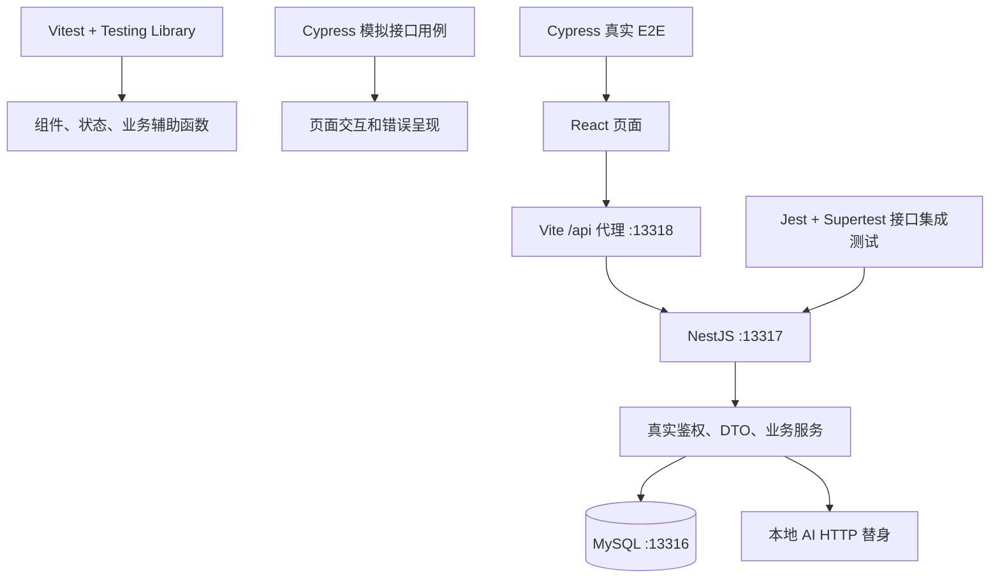

# English World 前后端测试架构

## 应用与测试层次

前端为 React + Vite 的 pnpm 工作区；English World 在 `apps/english-world`，请求封装位于 `packages/api`。后端为独立的 NestJS 仓库，Controller 接收请求，AuthGuard 和 DTO 校验后交给 Service，通过 Sequelize 访问 MySQL。

三层各自承担不同问题：组件测试验证交互和状态；接口集成测试验证认证、参数、用户隔离和数据库记录；真实 E2E 验证用户能完成跨页面业务。保留现有框架，不额外引入 Playwright 或独立测试管理平台。

## 一键执行与文件边界

`scripts/test-local.mjs` 启动后端 runner；后端创建临时数据库并先执行接口集成测试，通过后保持测试 API 运行。前端 runner 等待后端就绪，再启动 Vite 和 Cypress，保存报告后停止服务。异常退出返回非零状态。

| 文件 | 职责 |
|---|---|
| `scripts/test-local.mjs` | 跨仓库编排、就绪检查、日志、版本记录、进程清理 |
| `apps/english-world/vite.integration.config.ts` | 专用回环端口、隔离 API 代理、禁用本地 env 文件读取 |
| `apps/english-world/cypress.integration.config.ts` | 独立用例集、HTML 报告、数据库准备 Node task |
| `apps/english-world/cypress/integration/core.cy.ts` | 登录、导入、复习的真实浏览器操作 |
| 后端 `test/integration/harness.ts` | 真实 AppModule、数据库数据准备、外部 AI 替身 |

新用例放在 `cypress/integration`，不会混进原有 `cypress/e2e` 模拟接口测试入口。`cy.intercept()` 仅观察请求，未给业务接口编造响应。测试通过 Cookie 登录；使用 `cy.request()` 复查真实接口返回的数据，后端测试另行直接断言数据库记录数量。

## 数据与外部服务

每条用例执行 `cy.task('resetDatabase')`。该 task 在 Node 端调用后端 `seed.ts`，校验固定回环地址、测试端口和数据库名后重置数据。后端测试账号只有测试库权限；临时 MySQL 数据存于 tmpfs。生产应用没有数据库重置路由。

测试前置数据：主用户、第二用户、主用户的 `resilient` 单词。用例不依赖前一条的结果，也不访问日常开发数据库。固定 Compose 项目和端口由后端全机锁保护。

AI 只替换外部 HTTP 边界，批量导入的解析、冲突检测、确认和持久化仍是实际业务代码。Redis 缓存走未配置路径，OSS 上传不在首期覆盖范围。

## 明确的覆盖边界

- 后端测试库按当前 Sequelize 模型创建；仓库缺少完整初始化迁移链，不能据此证明存量数据库升级正确。
- 首期桌面浏览器 E2E 不证明 Safari、原生 iOS、PWA 离线和音频权限行为正确。
- 复习用例验证已提交结果刷新恢复，不验证未提交答案恢复。
- 页面已有提交中保护，但后端 `/recite/submit` 未实现幂等键；网络重试去重是后续需求，不能宣称已经验证。
- 测试入口保留生产核心中间件；生产 CORS、TLS、压缩和部署反向代理不在本地套件范围内。
- 前后端 SHA 与 dirty 标记记录在 `revisions.json`。有未提交改动的运行不能仅凭 SHA 完全复现，交付时应在干净检出中复测。

## GitHub 与后续 CI

本轮真实登录 E2E 发现桌面页面吞掉错误密码提示：共享 API 层为避免匿名探测弹窗而不提示业务码 4001，桌面表单又仅记录日志。现由表单显示可访问的错误 Alert，并通过组件回归和 AUTH-002 真实联测验证；无需改变匿名鉴权探测行为。

架构说明、用例清单和测试代码随各自仓库版本管理。第一期不新增 CI；未来只需让 CI 检出指定的前后端 SHA 后复用一键入口，并上传 HTML／JSON 报告和失败截图，无需重写测试逻辑。
